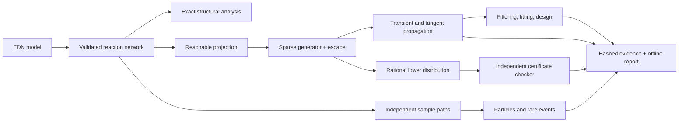

# Hazel

[](https://github.com/Aneesh495/hazel/actions/workflows/verify.yml)

A stochastic reaction laboratory in Clojure.

Hazel follows integer population distributions through reaction events, incomplete
observations, and changes in kinetic rates. An escaped trajectory changes what a
finite calculation can justify. The engine retains that probability and shows
how the answer changes as the projection grows.

The same model has three computational routes: a sparse master equation, seeded
sample paths, and a small-model rational calculation with a separate checker.
Their agreement is executable evidence. Each route has different limits.

## Run a study

Java 17 or newer is required. The launcher downloads three checksum-pinned
Clojure runtime JARs into `.cache/` on first use. No native libraries, database,
service, scientific Python environment, or account is needed.

```sh
git clone https://github.com/Aneesh495/hazel.git
cd hazel
bin/hazel run examples/telegraph.edn
make acceptance verify
```

Open `out/telegraph/index.html`. It is a self-contained HTML/SVG report with no
JavaScript or external assets. On Windows, use `bin/hazel.ps1` and run
`bin/clj.ps1 -m hazel.acceptance run`, then replace `run` with `verify`.
An installed Clojure CLI also works: `clojure -M:run help` and `clojure -M:test`.

## A small calculation with a checkable bound

```clojure
{:model
 {:name "Arrivals"
  :species [:x]
  :initial {:x 0}
  :parameters {:arrival 2}
  :reactions [{:id :arrival :reactants {} :products {:x 1} :rate :arrival}]}
 :experiment
 {:kind :certify :time 1
  :projection {:bounds [18]}
  :target {:species :x :op :>= :value 3}}}
```

The certificate encloses the event probability using exact integer and rational
operations. Its checker reconstructs rates from source reactions and uses a
separate dense recurrence. It does not invoke the floating-point propagator.

```sh
bin/hazel run examples/certificate.edn
# The run prints the content-addressed bundle path.
bin/hazel verify out/certificate/<digest>.edn
bin/hazel replay out/certificate/<digest>.edn
```

The certificate path is intentionally small: at most 64 population states and
64 time chunks. General transient analysis uses binary64 and reports analytic
truncation bounds separately from floating-point diagnostics.

## Mechanisms

| Layer | Implementation |
|---|---|
| Model | Inert EDN, explicit species order, combinatorial mass action, bounded reaction order |
| Structure | Exact conservation laws, complex graphs, linkage classes, deficiency |
| Master equation | Reachable projections, primitive CSR products, absorbing escape, adaptive restart |
| Numerical analysis | Chunked uniformization, Poisson tail bounds, an independent dense exponential |
| Exact bounds | Rational exponential enclosures, lower distributions, separate source-level checker |
| Rare events | First passage, competing risks, backward hitting equations, tilted path sampling |
| Simulation | Pure SplitMix64 streams, direct SSA, next-reaction clocks, deterministic parallel ensembles |
| Inference | Noisy observations, filtering, smoothing, continuous population bridges, tangent scores |
| Parameters | Bounded inverse-BFGS, profile likelihood, bootstrap particle filtering, pseudo-marginal MCMC |
| Further analysis | Information design, additive rewards, event-count moments, strong lumpability, time reversal |
| Symbolic analysis | Sparse polynomial generator actions and exact-closure moment hierarchies |
| Evidence | Canonical hashes, atomic bundles, strict replay, mutation controls, source-frozen acceptance |

Algorithms, inference, reports, tests, build tooling, and evidence orchestration
are Clojure. Shell and PowerShell only bootstrap the runtime.



## Explore

```sh
bin/hazel run examples/enzyme.edn             # Substrate completion time
bin/hazel run examples/telegraph-filter.edn   # Hidden promoter and incomplete counts
bin/hazel run examples/proofreading.edn       # Independent-snapshot information design
bin/hazel run examples/rare-arrivals.edn      # Path-space importance sampling
bin/hazel run examples/extinction-bridge.edn  # Continuous-time conditioned path
bin/hazel run examples/telegraph-moments.edn  # Symbolically closed moment equations
make jar
java -jar target/hazel.jar help
```

Every supplied study is executed and strictly replayed by acceptance. Packaging
is tested from outside the checkout. CI runs the complete campaign on Linux,
macOS, and Windows with JDK 17, 21, and 25. See the workflow for observed status.

## Read the implementation

Start with [architecture](docs/ARCHITECTURE.md), [numerical contracts](docs/NUMERICS.md),
and [exact certificates](docs/CERTIFICATES.md). Then follow
[model authoring](docs/MODELING.md), [inference](docs/INFERENCE.md),
[the API walkthrough](docs/API.md), and [example studies](docs/EXAMPLES.md).

[Verification](docs/VERIFICATION.md) describes the independent checks and their
limits. [Development](docs/DEVELOPMENT.md) covers changes, regressions, packaging,
and CI. [Measured results](docs/RESULTS.md), [known limits](docs/LIMITS.md),
[the regression ledger](docs/BUGS.md), and [references](docs/REFERENCES.md) keep
the claims tied to executable behavior.

The supplied biological models are schematic. No experimental dataset or
scientific calibration is implied. MIT license; the bundled runtime retains its
[own license notices](THIRD_PARTY.md).
