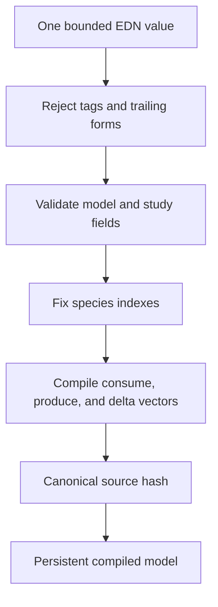
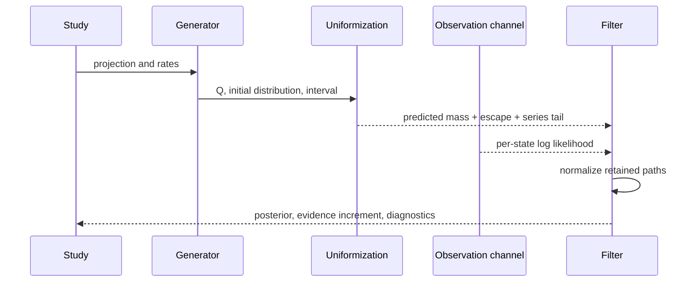

# Architecture

## Central contracts

A compiled model is immutable data. Species order is fixed once, rates retain
their input numeric types, and a source hash identifies the validated model.
There are no model-supplied functions or evaluated forms. A state is an integer
vector in species order, and every firing validates the resulting populations.

A finite projection is an ordered state set plus all outgoing reaction edges.
Edges crossing its boundary remain in the representation. Generator construction
aggregates them into a final absorbing escape state. No numerical method may
replace those edges with reflection without changing the model.

Sparse generators use a row convention. A row contains positive off-diagonal
rates; its diagonal is the negative exit rate. Probability is a row vector,
so the forward equation is `p' = p Q`. Backward value functions are columns.
The distinction is explicit in method names and differential tests.

## Module boundaries

| Namespace family | Responsibility | Owns mutable state? |
|---|---|---|
| `hazel.model` | Schema, compilation, propensities, structural identities, event predicates | No |
| `hazel.math` | Exact algebra, floating-point primitives, reference solvers, symbolic polynomials | Local work only |
| `hazel.ctmc` | Projection, generator, CSR kernel, transients, sensitivities, schedules, certificates | Private arrays in kernels |
| `hazel.simulation` | Random streams, direct and scheduled events, ensembles, path sampling | Pure streams; local executor |
| `hazel.inference` | Observation likelihoods, filters, smoothing, fitting, particles, MCMC | No global state |
| `hazel.analysis` | Passage, equilibrium, rewards, design, aggregation, moments, certificate checking | No global state |
| `hazel.io` | Bounded EDN, canonical hashes, atomic files, offline presentation | Filesystem boundary |
| `hazel.experiment` | Validated study dispatch | No |
| `hazel.cli` | Arguments, diagnostics, stable exit classification | Process boundary |
| `dev/hazel` | Test discovery, source manifests, controls, measurement, packaging, acceptance | Build and evidence directories |

The command layer does not implement numerical algorithms. The report layer
does not change a result. An inference routine receives a generator explicitly
and cannot quietly select a different truncation domain during differentiation.

## Model compilation

The compiler preserves the source model for replay. A parameter override creates
a new model with a new hash. Sensitivity and score entry points reject a
generator belonging to a different model.

Mass-action factors are exact binomial coefficients. Count availability is
checked before changing a state, and a zero constant disables a reaction. A
state-preserving reaction still exists in sample paths and event-count rewards,
although it contributes no off-diagonal population transition to `Q`.

## Reachability and projection

Breadth-first exploration starts at the initial state or explicit seeds. It
stores a deterministic discovery order, a reverse state index, reaction-labeled
edges, and boundary metadata. Bounds and a state budget are distinct constraints.
The frontier records which one blocked each edge.

Conservation laws provide some automatic population bounds. The detector only
uses nonnegative laws found in its basis. It does not solve the full invariant
cone, so a finite network can still require manually supplied bounds.

Adaptive projection grows bounds and restarts from the original point mass.
It never redistributes a previous escape probability among newly discovered
states. This makes the meaning of every attempt simple and keeps the mass-loss
argument intact. The cost is repeated work, retained in the refinement history.

Fixed projections support parameter comparisons. Their outgoing edges are
recomputed for each model, including transitions newly enabled by a changed
parameter. A fixed state set may therefore leak under one parameter value and
be closed under another. Convergence must be checked across the relevant range.

## Sparse execution

A persistent generator is the inspectable representation. `compile-kernel`
creates read-only primitive arrays for row offsets, destinations, rates, and
exit rates. Arrays are not exposed as result artifacts and are never modified
after construction. Each multiplication allocates its own output buffer.

For a sparse generator with `N` states and `E` edges, a forward or backward
product costs `O(N+E)`. Uniformization performs a sequence of these products.
The current implementation materializes persistent vectors between products.
It favors a small auditable kernel over an allocation-free numerical runtime.

Dense matrices have a separate role: small reference calculations, backward
linear systems, information matrices, and independent certificate checking.
They are not substituted into large sparse execution paths.

## Forward and backward analysis

The forward filter discards escaped paths because their observations are
unknown. Its result says that it is projection-conditioned. A backward smoother
uses column semigroup actions, while a likelihood score propagates the
derivative of each normalization constant.

Observation-grid bridges and continuous population bridges are different APIs.
The former sample latent states only at measurement times. The latter condition
the uniformized chain on two endpoints and assign continuous event times.
Neither reconstructs state-preserving chemical events.

## Simulation independence and concurrency

The direct simulator evaluates reactions against integer populations and never
builds a projection. The next-reaction simulator maintains per-reaction event
clocks, updating only affected hazards and the fired channel. Both preserve
full event histories when requested.

Random state is an explicit signed 64-bit integer. Ensemble stream identities
derive from trajectory indexes. Worker count does not affect seeds, output
order, or reduction order. The executor is bounded and shut down in `finally`.

Particle resampling clones populations, then assigns fresh descendant streams.
It does not clone a random stream together with an ancestor. PMMH retains the
current likelihood estimate when a proposal is rejected.

## Exact certificate boundary

The rational certificate path accepts exact integer and ratio inputs and has
small explicit state, series, and chunk limits. Its result is a lower
distribution plus a mass deficit. Each component is rational.

The checker is deliberately separate from the producer. It reads source
reaction maps, computes falling-factorial rates independently, reconstructs
the generator, and uses dense embedded-chain products. It does not call the
projection enumerator, propensity implementation, sparse kernel, or Poisson
series implementation.

This is an executable arithmetic check, not a proof-assistant development.
The trust base includes Clojure arithmetic, the JDK bigint implementation, the
model schema, and the mathematical argument in [certificates](CERTIFICATES.md).

## Persistence and replay

A bundle stores the validated source model, model hash, request, result, format,
and engine version. Its name is the SHA-256 digest of a canonical payload.
Impossible log weights have a reserved portable representation.

Files are written to a temporary sibling, flushed, fsynced, then atomically
renamed. The destination is never published as a partial file. This guarantees
atomic replacement on supported filesystems, not survival of every possible
power-loss scenario or authentication of an author.

Strict replay verifies hashes, reruns the requested computation, and compares
the entire canonical result. Different numerical platforms can disagree in
last-bit floating-point results. Generate and replay evidence on each supported
platform; rational certificate checking does not have that approximation issue.

## Source and package boundaries

Acceptance fingerprints implementation, tests, development tools, launchers,
resources, examples, dependency configuration, build configuration, and CI.
It checks the same manifest after all work. Evidence files and narrative docs
are excluded to avoid circular hashes.

The standalone JAR contains pinned runtime bytes and application Clojure source.
Only a minimal Clojure bootstrap is AOT-compiled. This avoids unstable closure
capture ordering in full-application AOT output. Dependency class entries are
newer than their source entries so the runtime selects its compiled classes.

The package regression checks two fresh builds on the same runtime, then runs
a study from an unrelated directory, checks its exact certificate, and strictly
replays it. A successful `help` invocation alone is insufficient.
