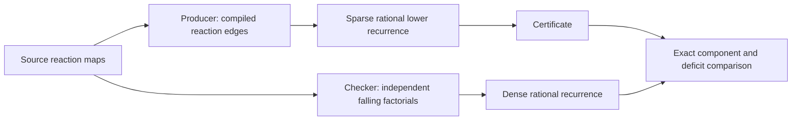

# Rational probability certificates

## Purpose and limits

The ordinary solver uses binary64 and distinguishes escaped probability from
series approximation. A very small floating-point residual is useful evidence,
but it is not a mathematical roundoff enclosure.

The certificate path instead computes a rational lower distribution. All rates,
time values, matrix products, and series coefficients in that calculation are
integers or ratios. The result includes an exact mass deficit that accounts for
every term deliberately omitted by this construction.

Supported limits are explicit:

| Quantity | Limit |
|---|---:|
| Population states | 64 |
| Additional escape states | 1 |
| Time chunks | 64 |
| Poisson polynomial order | 2 through 100 |
| Exponential enclosure order | 2 through 100 |

Use `7/10` for a rate intended to be exactly seven tenths. A binary64 literal
`0.7` is rejected by this path. The general solver accepts either form.
The certificate mode is a reference calculation, not a scalable replacement
for the sparse binary64 engine.

## Rational exponential enclosure

For rational `0 <= u <= 1`, define

\[
S_L(u)=\sum_{k=0}^{L}u^k/k!.
\]

The series terms are positive. Starting with the first omitted term, all
successive ratios are at most `u/(L+2)`. Therefore

\[
S_L(u)\leq e^u\leq S_L(u)+
{u^{L+1}/(L+1)!\over 1-u/(L+2)}=U_L(u).
\]

All operations on the right are rational. Taking reciprocals gives
`1/U_L(u) <= exp(-u) <= 1/S_L(u)`.

The producer only needs the lower factor `b=1/U_L(u)`. It does not convert a
floating-point exponential into a rational or infer a bound from printed digits.

## Lower-distribution recurrence

Let `P=I+Q/lambda` and `u=lambda*t/chunks <= 1`. For a nonnegative lower vector
`l`, one chunk computes

\[
T(l)=b\sum_{k=0}^{K}{u^k\over k!}lP^k.
\]

Because `P` is nonnegative, `b <= exp(-u)`, and the omitted series is
nonnegative, `T(l)` is componentwise below the exact chunk result. Repeating
this operation preserves the lower-distribution invariant.

The initial vector is an exact point mass. At the end, let

\[
d=1-\sum_i l_i.
\]

The checker verifies `d >= 0` and each component `l_i >= 0` exactly. Missing
probability is kept as `d`; it is never normalized away. For a retained event
`A`, an enclosure for the full reaction model is

\[
\left[\sum_{i\in A}l_i,
\min\left(1,\sum_{i\in A}l_i+l_{escape}+d\right)\right].
\]

This combines finite-projection escape and the exact recurrence deficit. It is
conservative because escaped trajectories might never satisfy the event.

## Independent checking

The checker in `hazel.analysis.certificate-check` is separate from the producer.
Its dependency list intentionally excludes the production propensity function,
projection enumerator, sparse kernel, uniformization solver, and certificate
producer.

It performs the following work:

1. Validate the model hash, dimensions, state uniqueness, numeric domain, and budgets
2. Reconstruct each reaction rate from the source species maps
3. Evaluate combinatorial factors by falling factorials divided by factorials
4. Rebuild generator rows, exits, the absorbing escape state, and the initial point mass
5. Recompute the rational exponential denominator
6. Propagate an independently constructed dense embedded chain
7. Compare every lower component, the mass deficit, escape, and truncation allowance

The command also recomputes any stored event interval from the checked
certificate and the requested inert predicate. Editing an interval while leaving
the core certificate intact cannot pass `hazel verify`.



## Use

```sh
bin/hazel run examples/certificate.edn
bin/hazel inspect out/certificate/<digest>.edn
bin/hazel verify out/certificate/<digest>.edn
```

The run prints the actual digest and bundle path. A bundle hash detects accidental
or unreconciled edits. A modified bundle whose hash has been recomputed still
must satisfy the independent arithmetic checker.

## Trust base

The checker is ordinary executable Clojure. Its exact arithmetic relies on the
language's integer/ratio operations and the JDK bigint implementation. Its
source-level semantics rely on the mass-action convention and the projection
argument. There is no proof-assistant kernel or verified compiler in this repo.

The checker verifies a specified model and arithmetic calculation. It does not
establish that the model describes a physical experiment, that an input rate was
measured correctly, or that a selected projection is an efficient one.

The regression suite corrupts lower probabilities, generator rows, deficits,
and model hashes. The acceptance campaign executes those controls. Its analytic
Poisson certificate check uses a separate rational enclosure, avoiding a test
that incorrectly treats an approximate binary64 reference as exact.
