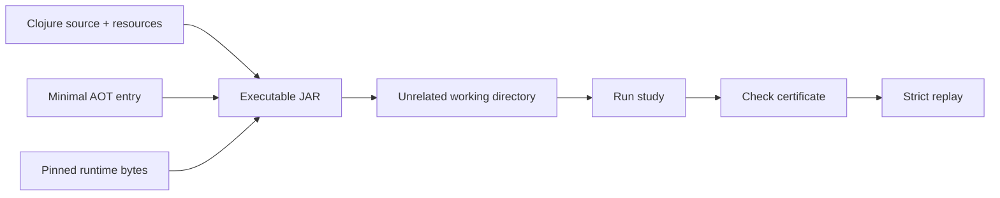

# ADR 004: a minimal AOT bootstrap and source-loaded application

Status: accepted

## Context

The source launcher worked while an early standalone JAR failed in a real report
path. Equal dependency source/class timestamps triggered runtime recompilation
and a protocol class-loader conflict. Full-application AOT builds also varied
in closure-capture ordering between fresh JVMs.

## Decision

Compile only a minimal Clojure entry class. Bundle application Clojure source,
resources, and pinned runtime artifacts. Give dependency class entries fixed
timestamps newer than source entries. Sort package entries and preserve licenses.

Test two fresh builds on the same runtime, then execute a complete study from
outside the checkout. Verify its rational certificate and strictly replay its
bundle. Keep subprocess logs.

## Consequences

The package follows the normal runtime JIT path and is independently usable
without source directories or a Clojure installation. Startup includes ordinary
namespace compilation. Byte identity is checked for the recorded runtime, not
promised across compiler or JDK releases.

